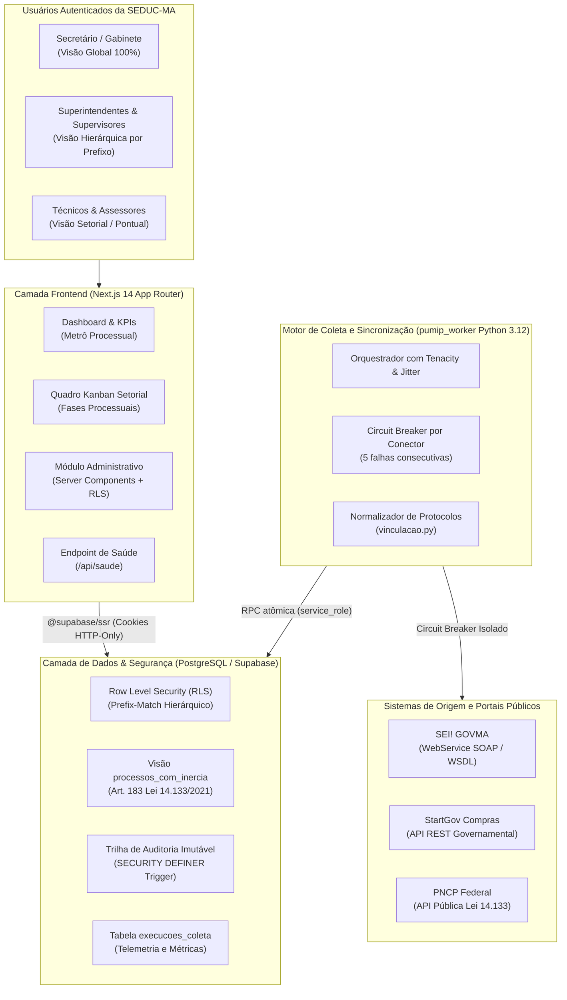

# PUMIP-SEDUC: Plataforma Unificada de Monitoramento e Inteligência Processual

> **Secretaria de Estado da Educação do Maranhão (SEDUC-MA)**  
> Sistema de Acompanhamento Integrado de Processos Administrativos e Contratações Públicas.  
> **Arquitetura Web Moderna, Versionada em Git e com Governança por Banco de Dados Relacional (PostgreSQL / Supabase RLS).**

[](https://github.com/SJuniorD3/pumip-seduc/actions/workflows/ci.yml)
[](https://github.com/SJuniorD3/pumip-seduc/actions/workflows/security-scan.yml)
[](docs/adr/ADR-003-RLS-HIERARQUICO-DIAS-UTEIS.md)
[](docs/RIPD-LGPD.md)

---

## 1. Visão Geral e Arquitetura do Sistema (C4 Model)

A **PUMIP** consolida em visão integrada o ciclo das demandas da SEDUC-MA que se iniciam na fase interna no **SEI! (GOVMA)** (DFD, ETP, TR) e prosseguem para contratação e licitação no **StartGov**, correlacionando dados com o **PNCP (Portal Nacional de Contratações Públicas)**.



---

## 2. Matriz de Maturidade Técnica e Remediação

| Dimensão Técnica | Estado Anterior | Estado Concluído (Etapas 1 a 9) |
| :--- | :---: | :---: |
| **Banco de Dados Local** | Inexistente / sem testes | Supabase CLI configurado + 5 migrações padronizadas + pgTAP |
| **Controle de Acesso (Auth)** | `localStorage` manipulável | `@supabase/ssr` com cookies server-side e layout blindado |
| **Camada de Dados** | Mocks misturados nas telas | DAL completa em `web/src/lib/dados/` com tipos estritos |
| **Motor de Coleta (Worker)** | Monólito de 1.100 linhas | Pacote modular `pumip_worker` com testes de contrato e circuit breaker |
| **Pirâmide de Testes** | Apenas testes unitários | Suíte de 4 camadas: pgTAP, Unit, Benchmarks e CI com 4 jobs |
| **Segurança de Dependências** | Vulnerabilidades em dependências | Dependabot ativo, overrides no npm e SAST com Semgrep/Gitleaks |
| **Acessibilidade Digital** | Fontes < 12px sem labels | Zero sub-12px (e-MAG), 100% inputs com labels e contraste >= 4.5:1 |
| **Observabilidade e SRE** | Sem endpoint de saúde | `/api/saude`, tabela `execucoes_coleta` e 3 Runbooks operacionais |
| **Governança e LGPD** | Sem documentação de privacidade | RIPD formal, ADRs arquiteturais, CODEOWNERS e estimativa de custos |

---

## 3. Instruções de Execução Local

### Pré-requisitos
- Node.js 20+ e npm
- Python 3.11+
- Docker (para executar o Supabase localmente)
- Supabase CLI (`brew install supabase/tap/supabase` ou `npm install -g supabase`)

### 1. Inicializar o Banco Local (Supabase CLI)
```bash
# Iniciar instâncias do PostgreSQL, Auth e Storage locais
supabase start

# Resetar o banco e aplicar todas as migrações e seed institucional
supabase db reset

# Executar a suíte de testes pgTAP no banco
supabase test db
```

### 2. Executar o Frontend (Next.js)
```bash
cd web

# Instalar dependências limpas
npm ci

# Executar testes unitários e benchmarks
npm run test:unit
npm run test:benchmarks

# Iniciar o servidor de desenvolvimento
npm run dev
# Acesse em: http://localhost:3000
```

### 3. Executar o Worker de Coleta (Python)
```bash
# Executar a suíte de testes do worker (compatível com pytest e unittest)
PYTHONPATH=worker python3 -m unittest discover -s worker/tests

# Executar uma rodada de sincronização manual
PYTHONPATH=worker python3 worker/pumip_worker/main.py
```

---

## 4. Documentação Técnica e Governança

- [Relatório de Impacto à Proteção de Dados (RIPD / LGPD)](docs/RIPD-LGPD.md)
- [ADR 001: Migração para @supabase/ssr e Proteção de Rotas](docs/adr/ADR-001-SUPABASE-SSR.md)
- [ADR 002: Pacote Modular pumip_worker e Circuit Breaker](docs/adr/ADR-002-WORKER-MODULAR-CIRCUIT-BREAKER.md)
- [ADR 003: Row Level Security e Prazos Lei 14.133/2021](docs/adr/ADR-003-RLS-HIERARQUICO-DIAS-UTEIS.md)
- [Runbook RB-01: Timeout no Conector SEI!](docs/runbooks/RB-01-TIMEOUT-SEI.md)
- [Runbook RB-02: Restauração de Circuit Breaker](docs/runbooks/RB-02-CIRCUIT-BREAKER.md)
- [Runbook RB-03: Renovação de Certificados mTLS](docs/runbooks/RB-03-MTLS-CERTIFICADOS.md)
- [Estimativa de Custos de Infraestrutura](docs/custos-infraestrutura.md)
- [Guia de Contribuição e Padrões de Código](CONTRIBUTING.md)
